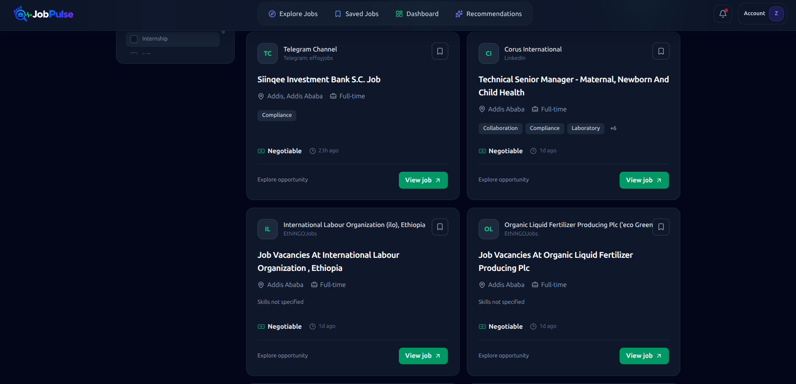
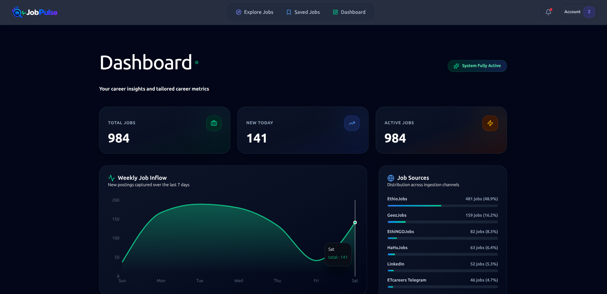
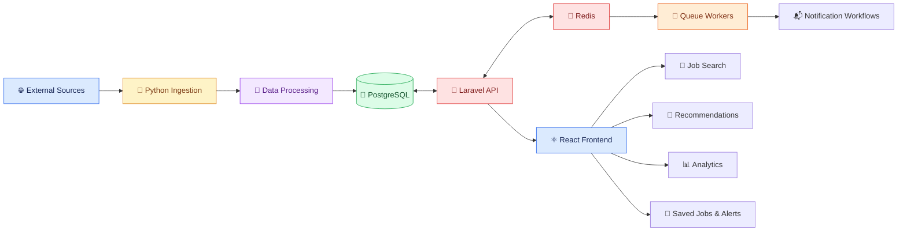
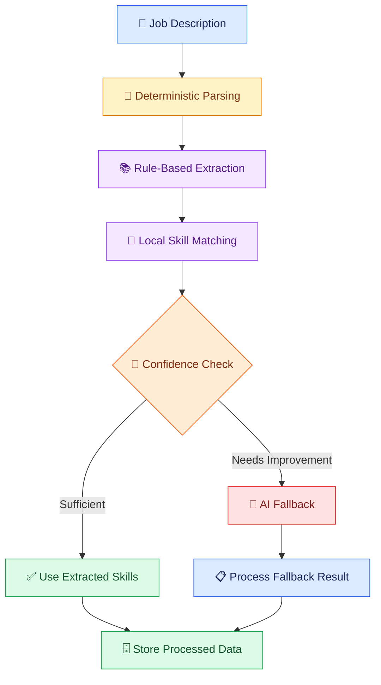

<div align="center">

# 🔍 JobPulse

### 🚀 Intelligent Job Discovery & Recommendation Platform

**One platform. Multiple 
a full-stack job intelligence platform that aggregates opportunities from Ethiopian and regional job boards, company career pages, and Telegram channels. It transforms fragmented job listings into a centralized, searchable, and personalized job discovery experience.

<br/>

[](https://job-pulse-five.vercel.app/)
[](https://github.com/zelalem3/JobPulse)
[](LICENSE)

<br/>

### 🛠️ Built With


<br/>

**🌍 Built to make job discovery more organized, accessible, and intelligent.**

</div>

---

## 📑 Table of Contents

- [🌟 Overview](#-overview)
- [🖥️ Application Preview](#️-application-preview)
- [✨ Key Features](#-key-features)
- [🏗️ System Architecture](#️-system-architecture)
- [🌐 Data Sources](#-data-sources)
- [⚙️ Data Processing Pipeline](#️-data-processing-pipeline)
- [🎯 Recommendation Engine](#-recommendation-engine)
- [🤖 AI & Skill Extraction](#-ai--skill-extraction)
- [🧰 Technology Stack](#-technology-stack)
- [🔌 API Overview](#-api-overview)
- [🚀 Getting Started](#-getting-started)
- [🐳 Docker Development](#-docker-development)
- [🧪 Testing](#-testing)
- [📁 Project Structure](#-project-structure)
- [💡 Engineering Principles](#-engineering-principles)
- [🛣️ Future Improvements](#️-future-improvements)
- [🌐 Live Application](#-live-application)
- [👨‍💻 Author](#-author)
- [📄 License](#-license)

---

## 🌟 Overview

Finding job opportunities in Ethiopia often means searching across multiple job boards, company career pages, professional networks, and messaging channels.

The same vacancy can appear on different platforms with inconsistent titles, incomplete descriptions, duplicate listings, and different application deadlines.

**JobPulse brings these opportunities together in one searchable platform.**

The application combines automated data collection, data normalization, duplicate detection, skill extraction, personalized recommendations, and notification delivery.

### 🎯 The Problem

- 🔎 Job opportunities are scattered across multiple platforms.
- 🔁 The same vacancy may appear more than once.
- 🧹 Job descriptions often contain inconsistent or incomplete information.
- 🎯 Finding jobs relevant to a particular skill set can be time-consuming.
- 🔔 Relevant opportunities can be missed without a reliable monitoring workflow.

### 💡 The Solution

JobPulse provides a unified workflow for collecting, processing, discovering, and recommending job opportunities.

| Capability | What It Does |
|:---|:---|
| 🌐 Aggregation | Collects opportunities from multiple sources |
| 🧹 Data Quality | Normalizes listings and identifies duplicates |
| 🔍 Discovery | Provides centralized search and filtering |
| 🎯 Personalization | Matches job requirements against user skills |
| 🔔 Notifications | Supports email and Telegram notification workflows |
| 📊 Analytics | Visualizes job-market activity and in-demand skills |
| ⚙️ Automation | Uses background processing for suitable tasks |


## ⚙️ How JobPulse Works

JobPulse transforms scattered job listings into a centralized, searchable, and personalized job discovery experience.

### 🔄 The Data Pipeline

<table>
  <tr>
    <td align="center" width="33%">
      <h3>🌐 01. Collect</h3>
      Gather job listings from job boards, company career pages, and Telegram channels using Python scrapers.
    </td>
    <td align="center" width="33%">
      <h3>🧹 02. Process</h3>
      Normalize job data, validate listings, remove duplicates, extract skills, and calculate quality scores.
    </td>
    <td align="center" width="33%">
      <h3>🗄️ 03. Store</h3>
      Save structured job listings and related information in PostgreSQL.
    </td>
  </tr>
  <tr>
    <td align="center">
      <h3>⚡ 04. Serve</h3>
      Expose job data and application functionality through the Laravel REST API.
    </td>
    <td align="center">
      <h3>🎯 05. Personalize</h3>
      Help users discover relevant opportunities through search, skill matching, and recommendations.
    </td>
    <td align="center">
      <h3>📬 06. Notify</h3>
      Use background workers to process queued tasks and deliver supported email and Telegram notifications.
    </td>
  </tr>
</table>

### 🏗️ Application Architecture

| Component | Responsibility |
|:---|:---|
| 🐍 **Python Scrapers** | Collect job listings from multiple sources. |
| 🧠 **Processing Pipeline** | Normalize data, detect duplicates, extract skills, and assess listing quality. |
| 🐘 **PostgreSQL** | Persist job listings and application data. |
| ⚙️ **Laravel REST API** | Handle application logic and serve data to the frontend. |
| 🔴 **Redis** | Support queued background processing. |
| 👷 **Background Workers** | Process asynchronous tasks and notifications. |
| ⚛️ **React + TypeScript** | Power the interactive job discovery interface. |

### ✨ What Users Can Do

- 🔍 **Discover jobs** — Search and filter opportunities from multiple sources.
- 🎯 **Find relevant opportunities** — Explore personalized recommendations based on skill matches.
- 💾 **Save jobs** — Keep track of interesting opportunities.
- 🔔 **Create alerts** — Monitor opportunities matching selected criteria.
- 📊 **Explore job market insights** — View analytics about collected listings.
- 📩 **Receive notifications** — Get supported email and Telegram job alerts.

> **The goal:** Turn fragmented job listings into a more organized and useful job-search experience.


### 🚀 What Makes JobPulse Different?

- 🌍 **Multi-source aggregation:** Collects opportunities from different platforms in one place.
- 🧹 **Data quality first:** Normalizes and deduplicates listings before presenting them.
- 🎯 **Personalized discovery:** Helps users identify opportunities relevant to their skills and preferences.
- ⚡ **Asynchronous processing:** Uses Redis-backed queues for background workloads.
- 💰 **Cost-aware AI:** Prioritizes deterministic processing and local skill matching before using AI fallbacks.
- 📊 **Practical analytics:** Converts collected listings into insights about companies, skills, and job-market activity.

---

## 🖥️ Application Preview

Explore JobPulse through the live application:

<div align="center">

### 🔎 Job Discovery

Search and filter job opportunities collected from multiple sources.



### 🎯 Personalized Recommendations

Discover relevant opportunities with match scores and matched or missing skills.


### 📊 Job Market Analytics

Explore job statistics, popular skills, companies, and posting trends.



<br/>

[](https://job-pulse-five.vercel.app/)

</div>


---

## ✨ Key Features

### 🔎 1. Centralized Job Discovery

Find opportunities without manually navigating multiple job websites.

- 🔍 Search job titles and descriptions.
- 📍 Filter by location.
- 🏢 Filter by source and other supported job attributes.
- 💼 Filter by employment type and experience level.
- 🧠 Filter using relevant skills and categories.
- 📄 Browse paginated results, configured for 60 jobs per page.
- 📋 View job descriptions, responsibilities, requirements, and deadlines.
- 🔗 Navigate to the original application source.
- 🟢 Exclude inactive listings from public job discovery.

### 🎯 2. Personalized Recommendations

Connect users with opportunities that are relevant to their profiles.

- 🧠 Compare user skills with job requirements.
- 📍 Consider location preferences.
- 💼 Account for employment preferences.
- 📊 Display recommendation match scores.
- ✅ Highlight matched skills.
- 📚 Identify relevant missing skills.
- ⚙️ Support background processing through Redis-backed queues.

The goal is to make recommendations more informative than a list of job titles alone.

### 💾 3. Saved Jobs

Keep interesting opportunities organized for later.

- 🔖 Save job listings to an authenticated account.
- 🔄 Persist saved jobs across sessions.
- 📂 Retrieve and manage saved opportunities.
- 👤 Access saved listings through the application interface.

### 🔔 4. Job Alerts

Monitor opportunities that match user-defined criteria.

- ⚙️ Configure alerts using keywords and supported filters.
- 🎯 Match job opportunities against alert criteria.
- 📧 Support email notifications.
- 📨 Integrate Telegram notifications.
- 🛠️ Create and manage alerts through the frontend.
- 🧪 Test email delivery locally using Mailpit.

### 📊 5. Job Market Analytics

Explore insights from collected job listings through interactive visualizations.

- 📈 Job posting trends.
- 🟢 Active job counts.
- 🏢 Top companies.
- 🧠 Most requested skills.
- 💾 Saved-job statistics.

**Visualization library:** Recharts.

### 📨 6. Telegram Integration

Connect Telegram to job collection and notification workflows.

- 📥 Collect supported listings from Telegram job channels.
- 🔗 Process Telegram webhook events.
- 👤 Connect Telegram to user accounts.
- 🟢 Track connection status.
- 🔔 Send job notifications.
- 🔁 Avoid duplicate notification delivery where supported by the implementation.

---

## 🏗️ System Architecture

JobPulse separates data ingestion, API processing, persistent storage, asynchronous execution, and frontend presentation into distinct components.

### 🧩 Architecture Components

| Component | Technology | Responsibility |
|:---|:---|:---|
| 🌐 Data Sources | Job boards, career pages, Telegram | Provide job listings |
| 🕷️ Ingestion | Python, Playwright, Requests | Collect and parse external data |
| 🧹 Processing | Python | Normalize, validate, deduplicate, and enrich listings |
| 🗄️ Database | PostgreSQL | Persist job listings and application data |
| 🔌 Backend | Laravel REST API | Expose application functionality |
| ⚡ Queue Infrastructure | Redis | Support caching and asynchronous workloads |
| 👷 Workers | Laravel queue workers | Execute background jobs |
| 🎨 Frontend | React, TypeScript, Vite | Provide discovery, recommendations, and dashboards |
| 📬 Notifications | Email, Telegram | Deliver relevant job notifications |
| 🌍 Web Server | Nginx | Route requests within the configured deployment |
| 📦 Development Environment | Docker Compose | Coordinate application services |

### 🔄 Request and Processing Flow



### 🧱 Architectural Responsibilities

- **Ingestion layer:** Collects external job data.
- **Processing layer:** Improves consistency and identifies duplicates.
- **Persistence layer:** Stores processed listings and application data.
- **API layer:** Exposes application operations to the frontend.
- **Queue layer:** Supports suitable background workloads.
- **Presentation layer:** Provides the user-facing job discovery experience.
- **Notification layer:** Supports email and Telegram delivery.

> ℹ️ The exact execution flow depends on the configured scraper schedules, API routes, queue workers, and deployment environment.

---

## 🌐 Data Sources

JobPulse is designed to aggregate opportunities from multiple job boards, company career pages, professional networks, and Telegram channels.

### 📚 Supported Source Integrations

| Source | Category |
|:---|:---|
| 🌍 EthioJobs | Job board |
| 🌍 EthioJob.org | Job board |
| 🌍 EthioJobsInfo | Job board |
| 🌍 GeezJobs | Job board |
| 🌍 Afriwork | Job board |
| 🌍 Hahu | Job board |
| 📰 EthioReporter | Media and job listings |
| 🤝 EthioNgoJobs | NGO-focused listings |
| 🏢 Ethiopian Airlines | Company careers |
| 🏢 EthioTelecom | Company careers |
| 🏢 Safaricom | Company careers |
| 💼 LinkedIn | Professional network |
| 📨 Telegram Channels | Messaging and job distribution |

The scraper collection is designed to be extensible, allowing additional sources to be integrated as their parsing requirements are implemented.

### 🛠️ Data Collection Technologies


- 🐍 Python for scraping and processing.
- 🎭 Playwright for browser-based extraction where required.
- 🌐 Requests for HTTP-based collection.
- 🍲 BeautifulSoup for HTML parsing.
- ⚡ asyncio for asynchronous workflows where appropriate.

> ⚠️ Source availability depends on website structure, access restrictions, and the current state of each scraper. Check the repository for the integrations that are actively supported.

---

## ⚙️ Data Processing Pipeline

Raw job listings must be transformed into consistent, searchable records before they can provide useful recommendations.

JobPulse uses a multi-stage ingestion pipeline to improve data quality and reduce duplication.

### 🔄 Processing Stages

| Stage | Purpose |
|:---|:---|
| 📥 Parsing | Extract job fields from external sources |
| 🧹 Normalization | Standardize titles, companies, locations, dates, and URLs |
| ✅ Validation | Identify incomplete or invalid records |
| 🔁 Deduplication | Detect duplicate listings across sources |
| 🏢 Company Resolution | Associate listings with canonical company records |
| 🧠 Skill Extraction | Identify relevant skills in job descriptions |
| 📊 Quality Scoring | Evaluate listing quality |
| 🗄️ Storage | Persist processed listings in PostgreSQL |
| 🟢 Status Management | Control which listings appear in public search |

### 🔁 Multi-Signal Deduplication

A vacancy may be published on multiple platforms with different titles, URLs, and descriptions.

JobPulse uses multiple signals to identify potential duplicates, including:

- 🔗 Canonical or normalized URLs.
- #️⃣ Content fingerprints and hashes.
- 📝 Fuzzy job-title similarity.
- 🏢 Company-name similarity.
- 📅 Posting-date proximity.
- 🌐 Cross-source matching.
- 🔄 Rules designed to prevent the re-insertion of previously deactivated jobs.

Combining these signals helps identify the same vacancy even when different sources present it differently.

### 🟢 Active Job Management

JobPulse distinguishes between stored records and publicly discoverable opportunities.

Active-status filtering helps keep expired or deactivated listings out of public search results and filter options.

**Result:** A more consistent foundation for searching, analytics, and personalized recommendations.

---

## 🎯 Recommendation Engine

JobPulse provides personalized recommendations using information about users and job listings.

### 🧠 Recommendation Signals

| Signal | Purpose |
|:---|:---|
| 🛠️ Skills | Compare user skills with job requirements |
| 📍 Location | Account for location preferences |
| 💼 Employment Preferences | Consider preferred employment types |
| 👨‍💻 Experience | Evaluate experience-related relevance |
| 📊 Job Quality | Incorporate listing quality |
| 🕒 Recency | Account for how recently an opportunity was posted |

### 📈 Explainable Skill Matching

The recommendation interface distinguishes between two important categories:

- ✅ **Matched Skills:** Skills associated with both the user's profile and the job requirements.
- 📚 **Missing Skills:** Relevant job skills not found in the user's current skill profile.

This provides more useful feedback than displaying a recommendation score alone.

For example, a user might see which requirements already match their profile and which additional skills appear in the listing.

### ⚡ Background Processing

Redis-backed queues support suitable background tasks so that expensive processing does not always need to happen during a user's immediate request.

> ℹ️ Exact scoring weights, queue behavior, and recommendation refresh schedules depend on the implementation in the repository.

---

## 🤖 AI & Skill Extraction

JobPulse follows a **cost-aware approach to skill extraction**.

Rather than relying on an AI model for every listing, it prioritizes deterministic processing and local matching.

### 🔄 Extraction Workflow



### 💡 Why This Approach?

- 💰 Reduces unnecessary external API calls.
- ⚡ Lowers processing costs.
- 🔁 Improves reproducibility for common cases.
- 🐛 Makes extraction behavior easier to debug.
- 🔌 Reduces dependence on external AI services.
- 🧩 Keeps common extraction tasks independent of AI availability.

Gemini is used as a fallback where configured and when the local processing strategy cannot confidently resolve a case.

---

## 🧰 Technology Stack

JobPulse combines a modern frontend, a Laravel backend, Python-based ingestion, and supporting infrastructure.

### 🎨 Frontend


### ⚙️ Backend & Data


### 🕷️ Ingestion & Automation


### 🐳 Infrastructure & Development


### 📋 Stack Summary

| Layer | Technologies |
|:---|:---|
| 🎨 Frontend | React, TypeScript, Vite |
| 💅 Styling | Tailwind CSS |
| 📊 Visualization | Recharts |
| ⚙️ Backend | Laravel, PHP |
| 🔐 Authentication | Laravel Sanctum |
| 🗄️ Database | PostgreSQL |
| ⚡ Caching & Queues | Redis |
| 🕷️ Data Ingestion | Python, Playwright, Requests, BeautifulSoup, asyncio |
| 👷 Background Workers | Laravel queue workers |
| 📬 Notifications | Email, Telegram |
| 🧪 Local Email Testing | Mailpit |
| 🌍 Web Server | Nginx |
| 📦 Containers | Docker, Docker Compose |
| 🔄 CI/CD | GitHub Actions |

---

## 🔌 API Overview

JobPulse exposes REST endpoints for authentication, job discovery, saved jobs, alerts, recommendations, and dashboard analytics.

> ⚠️ **API documentation note:** The routes below are a reference based on the documented application structure. Verify the exact paths, HTTP methods, middleware, and response formats against `backend/routes/api.php` before treating this table as definitive.

### 🔐 Authentication

| Method | Endpoint | Description |
|:---|:---|:---|
| `POST` | `/api/auth/register` | Register a user |
| `POST` | `/api/auth/login` | Authenticate a user |

### 🔎 Job Discovery

| Method | Endpoint | Description |
|:---|:---|:---|
| `GET` | `/api/jobs` | Retrieve active job listings |
| `GET` | `/api/jobs/{id}` | Retrieve job details |
| `GET` | `/api/jobs/search` | Search job listings |
| `GET` | `/api/jobs/filters` | Retrieve available filter options |

### 💾 Saved Jobs

| Method | Endpoint | Description |
|:---|:---|:---|
| `GET` | `/api/savedjobs` | Retrieve saved jobs |
| `POST` | `/api/savejob/{id}` | Save or toggle a job's saved state |

### 🔔 Job Alerts

| Method | Endpoint | Description |
|:---|:---|:---|
| `GET` | `/api/alerts` | Retrieve user alerts |
| `POST` | `/api/alerts` | Create an alert |
| `PUT` | `/api/alerts/{id}` | Update an alert |
| `DELETE` | `/api/alerts/{id}` | Delete an alert |

### 🎯 Recommendations

| Method | Endpoint | Description |
|:---|:---|:---|
| `GET` | `/api/recommendations` | Retrieve personalized recommendations |

### 📊 Dashboard

| Method | Endpoint | Description |
|:---|:---|:---|
| `GET` | `/api/dashboard/stats` | Retrieve dashboard statistics |
| `GET` | `/api/dashboard/topcompanies` | Retrieve top companies |
| `GET` | `/api/dashboard/skills` | Retrieve popular skills |
| `GET` | `/api/dashboard/graph` | Retrieve job-market trends |

### 🔐 Authentication & Security

Authentication is handled by Laravel Sanctum.

Protected operations include user-specific resources such as saved jobs, recommendations, alerts, profiles, and Telegram integrations, subject to the configured route middleware.

---

## 🚀 Getting Started

You can run JobPulse locally using Docker Compose.

### 📋 Prerequisites

Install the following tools:

- 🐙 Git
- 🐳 Docker Engine
- 📦 Docker Compose
- 🌐 Internet access for downloading dependencies

Optional integrations may also require credentials, such as Telegram bot tokens or external AI provider API keys.

### 1️⃣ Clone the Repository

```bash
git clone https://github.com/zelalem3/JobPulse.git

cd JobPulse
```

### 2️⃣ Configure Environment Variables

Review the configuration requirements for the backend, frontend, scrapers, and supporting services.

Depending on your repository configuration, these may include:

- 🗄️ Database connection settings.
- ⚡ Redis connection settings.
- 🔐 Laravel application configuration.
- 🌐 Frontend API URL.
- 📨 Telegram bot credentials.
- 🤖 Optional AI provider credentials.

Use the environment files or templates provided by the repository.

**🔒 Security reminder:** Never commit real API keys, passwords, bot tokens, or other secrets to Git.

### 3️⃣ Build and Start the Application

```bash
docker compose up -d --build
```

Check the running services:

```bash
docker compose ps
```

### 4️⃣ Install Backend Dependencies

If the backend image does not install Composer dependencies automatically:

```bash
docker compose exec backend composer install
```

Generate the Laravel application key if one has not already been configured:

```bash
docker compose exec backend php artisan key:generate
```

Run database migrations:

```bash
docker compose exec backend php artisan migrate
```

### 5️⃣ Install Frontend Dependencies

If required by the frontend container:

```bash
docker compose exec frontend npm install
```

### 6️⃣ Verify Redis

Check the Redis connection:

```bash
docker compose exec redis redis-cli ping
```

Expected output:

```text
PONG
```

### 7️⃣ Inspect Logs

**Backend logs**

```bash
docker compose logs -f backend
```

**Queue worker logs**

```bash
docker compose logs -f queue-worker
```

**Scraper logs**

```bash
docker compose logs -f scrapers
```


---

## 🐳 Docker Development

JobPulse uses Docker Compose to run its application components as separate services.

### 🧩 Services

| Service | Responsibility |
|:---|:---|
| 🎨 Frontend | React and TypeScript application |
| ⚙️ Backend | Laravel REST API |
| 👷 Queue Worker | Asynchronous processing |
| 🕷️ Scrapers | External job ingestion |
| 🐘 PostgreSQL | Persistent database |
| 🔴 Redis | Cache and queue infrastructure |
| 🌍 Nginx | Request routing and web serving |
| 📬 Mailpit | Local email testing |

### 🛠️ Useful Commands

**▶️ Start services**

```bash
docker compose up -d
```

**🔨 Rebuild and start services**

```bash
docker compose up -d --build
```

**⏹️ Stop services**

```bash
docker compose down
```

**📋 Check service status**

```bash
docker compose ps
```

**📜 Follow all logs**

```bash
docker compose logs -f
```

**🐚 Open a Laravel container shell**

```bash
docker compose exec backend sh
```

**🗄️ Run database migrations**

```bash
docker compose exec backend php artisan migrate
```

**🧪 Run backend tests**

```bash
docker compose exec backend php artisan test
```

**🔍 Run frontend linting**

```bash
docker compose exec frontend npm run lint
```


---

## 🧪 Testing

Testing should cover the behavior of each major subsystem.

### ⚙️ Backend Testing

Recommended areas include:

- 🔐 Authentication and authorization.
- 📥 Job ingestion and validation.
- 🔁 Duplicate detection.
- 🟢 Active-job filtering.
- 🔎 Search and filtering.
- 🎯 Recommendation generation.
- 💾 Saved-job operations.
- 🔔 Alert management.
- 📬 Notification processing.

Run backend tests:

```bash
docker compose exec backend php artisan test
```

### 🎨 Frontend Testing

Recommended areas include:

- 🃏 Job cards and detail pages.
- 🔎 Search and filter interactions.
- 🔐 Authentication state.
- 🎯 Recommendations.
- 💾 Saved jobs.
- 🔔 Alert management.
- ⏳ Loading, error, and empty states.

Run frontend linting:

```bash
docker compose exec frontend npm run lint
```

### 🕷️ Scraper Testing

Recommended areas include:

- 🌐 Source-specific parsing.
- 🧩 Missing and malformed fields.
- 📅 URL and date normalization.
- 🗂️ Category-based scraping.
- 🔁 Duplicate handling.
- 🛡️ Failure isolation.

Scraper test commands depend on the testing framework and scripts configured in `scrapers/`.


---

## 📁 Project Structure

The following illustrates the major areas of the repository. Individual directory names and additional files may vary as the project evolves.

```text
JobPulse/
│
├── 📂 backend/
│   ├── app/
│   │   ├── Http/
│   │   ├── Models/
│   │   └── Services/
│   ├── routes/
│   │   └── api.php
│   ├── database/
│   ├── tests/
│   └── ...
│
├── 📂 frontend/
│   ├── src/
│   │   ├── components/
│   │   ├── pages/
│   │   ├── services/
│   │   └── ...
│   └── ...
│
├── 📂 scrapers/
│   ├── Afriwork/
│   ├── Ethiojob/
│   ├── EthioJoborg/
│   ├── GeezJobs/
│   ├── telegram/
│   ├── linkedin/
│   ├── common/
│   └── ...
│
├── 📂 nginx/
├── 📂 docs/
│   └── 📂 screenshots/
│       ├── jobs.png
│       ├── recommendations.png
│       └── dashboard.png
│
├── 🐳 docker-compose.yml
├── 📄 LICENSE
└── 📘 README.md
```

### 📦 Main Components

| Directory | Purpose |
|:---|:---|
| `backend/` | Laravel API, business logic, models, and database operations |
| `frontend/` | React application, pages, components, and API integration |
| `scrapers/` | Job-source integrations and data collection |
| `nginx/` | Web server and request routing configuration |
| `docs/` | Project documentation and screenshots |
| `docker-compose.yml` | Local multi-service development configuration |

---

## 💡 Engineering Principles

### 🧹 1. Data Quality First

Reliable recommendations depend on reliable input data. Normalization, validation, deduplication, and active-status management help improve the quality of searchable listings.

### 🧠 2. Prefer Deterministic Processing

Use straightforward parsing and local matching wherever possible. Introduce AI when it provides meaningful additional value.

### 🧩 3. Separate Responsibilities

Keep ingestion, API logic, data storage, asynchronous execution, and frontend presentation separate.

### ⚡ 4. Use Asynchronous Processing Where Appropriate

Move suitable background tasks into queues so that API requests do not need to perform every operation synchronously.

### 🛠️ 5. Design for Maintainability

Keep data-source integrations modular, make processing behavior understandable, and test important edge cases.

### 🎯 6. Optimize for the User

Prioritize clear job details, useful filters, transparent recommendation scores, and responsive interfaces.

### 💰 7. Be Cost-Aware

Prefer efficient local processing when it is sufficient, and use external services when their additional capabilities justify the cost.

---

## 🛣️ Future Improvements

Potential areas for continued development include:

- 🧪 Expanding automated test coverage.
- 📡 Improving scraper monitoring and failure reporting.
- 🕒 Adding data-freshness indicators.
- 🔁 Improving duplicate detection for difficult cross-source cases.
- 🎯 Refining recommendation explanations.
- 📊 Adding more detailed job-market analytics.
- ⚙️ Improving queue monitoring and operational visibility.
- 📚 Documenting API request and response schemas.
- 🔄 Adding more automated CI checks.
- 🌐 Expanding supported job sources.

> 💡 These are potential development directions rather than claims about functionality already implemented.

---


<div align="center">

## 🌐 Live Application

### 🚀 Ready to Explore JobPulse?

Discover job opportunities through a unified search and recommendation experience.

<br/>

[](https://job-pulse-five.vercel.app/)

<br/>

[](https://github.com/zelalem3/JobPulse)

</div>

---
<div align="center">
       
### 👨‍💻 Author


## Zelalem Getnet

**Full-Stack Software Engineer · Computer Science Graduate**

Interested in backend architecture, data pipelines, real-time systems, PostgreSQL, Redis, Docker, and intelligent software systems.

<br/>

[](https://github.com/zelalem3)

[](https://www.linkedin.com/in/zelalem-getnet-533326246/)

</div>

---
<div align="center">
       
## 📄 License

This project is licensed under the **MIT License**.

See the [`LICENSE`](LICENSE) file for details.

</div>
---

<div align="center">

## 💜 JobPulse

**Turning fragmented job listings into a more organized job discovery experience.**


<br/>

[🌐 Live Demo](https://job-pulse-five.vercel.app/) · [💻 GitHub Repository](https://github.com/zelalem3/JobPulse) · [👨‍💻 Author](https://github.com/zelalem3)

<br/>


**⭐ If you find JobPulse interesting, consider giving the repository a star!**

</div>
